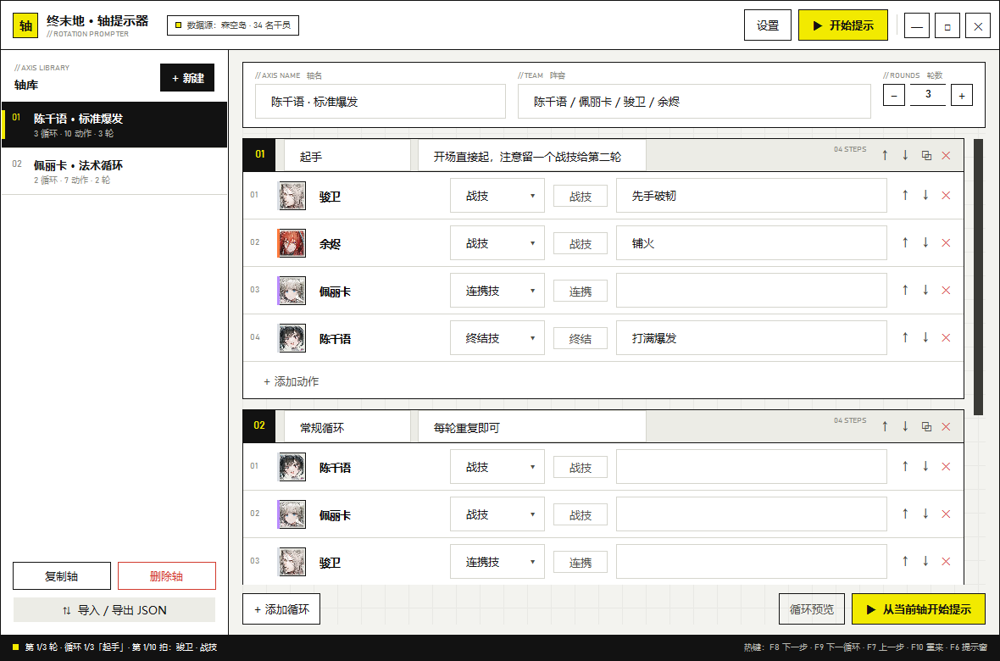
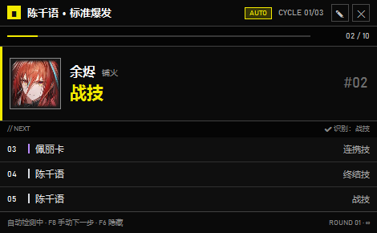
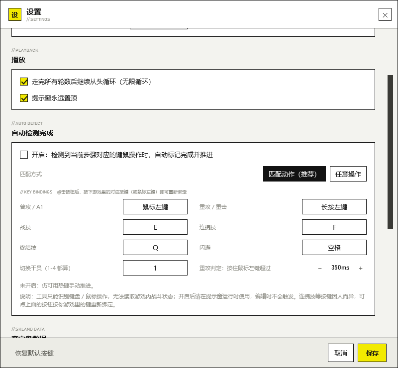
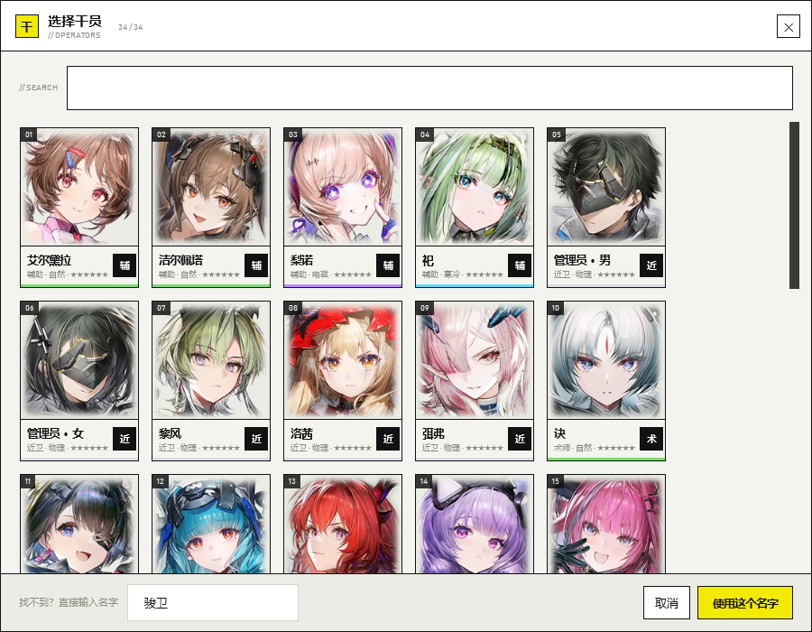

# 终末地 · 轴提示器（Endfield Rotation Prompter）

[](https://github.com/MEIMAOA/EndfieldAxisTeller/actions/workflows/build.yml)
[](LICENSE)
[](https://github.com/MEIMAOA/EndfieldAxisTeller/releases)

[下载 Releases](https://github.com/MEIMAOA/EndfieldAxisTeller/releases) · [问题反馈](https://github.com/MEIMAOA/EndfieldAxisTeller/issues) · [更新日志](https://github.com/MEIMAOA/EndfieldAxisTeller/commits/main)

给《明日方舟：终末地》用的**战斗轴提示工具**：把一条轴拆成多段循环、每个循环里放干员和动作，
开打后挂在屏幕角落，按一下键就推进一个动作，走完一段循环自动进入下一段循环，再也不怕记错顺序。

- 平台：Windows 10 / 11（WPF，.NET 10）
- 数据：内置终末地干员图鉴（含头像），可在设置里用**森空岛**账号同步你实际拥有的干员
- 特点：多轴多循环、全局热键、置顶悬浮窗、可视化编辑、自动保存、JSON 导入导出
- 自动检测：开启后，只要按出当前步骤对应的动作（普攻 / 重攻 / 战技 / 连携 / 终结 / 闪避 / 切换），
  就**自动判定当前步骤完成并推进**，不用再额外按键
- 界面：整体视觉参照《终末地》官网（白底 / 黑色实块 / 荧光黄 / 直角细线 / 等宽编号），
  悬浮提示窗参照游戏内「任务目标」追踪面板重做（深色横条、进度条、接下来几拍）



| 悬浮提示窗 | 设置 |
| --- | --- |
|  |  |

### 悬浮提示窗

参照游戏内左上角的任务目标追踪面板设计：

- 顶部：轴名 + 当前循环（`CYCLE 01/03`），右侧是编辑 / 关闭按钮；
- 进度条：本轮第几拍 / 总拍数，荧光黄填充；
- 当前动作：干员头像、名字、动作（黄色大字）、备注、序号；
- 接下来 3 拍：序号 + 属性色条 + 干员名 + 动作，快走完本循环时会提示 `→ NEXT CYCLE` / `→ NEXT ROUND`；
- 底部：全局热键提示 + 当前轮数（单次模式显示 `ROUND 01/03`，无限模式显示 `ROUND 01 · ∞`）；
- 开启自动检测后，右上角显示 `AUTO`，识别到动作时「接下来」行会闪出 `✔ 识别：战技`。

提示窗可拖动，默认贴左上角，位置会记住；双击回到编辑界面，右键可切换轴 / 重置 / 隐藏 / 退出。

| 干员选择 |
| --- |
|  |


---

## 快速开始

1. 到 [Releases](https://github.com/MEIMAOA/EndfieldAxisTeller/releases) 下载 `EndfieldAxisTeller-*-win-x64.zip`，
   解压后运行 `AxisTeller.exe`（或 `启动.bat`）；也可以自行 `dotnet run`（见下方「开发」）。
2. 左侧「轴库」里选中一条轴（第一次启动自带两条示例轴），右边直接改：
   - **轴名 / 阵容 / 轮数**：轮数 = 整条轴重复几遍。
   - **循环**：一条轴可以有多段循环，每段可以改名写备注，支持上移/下移/复制/删除。
   - **动作**：点干员头像换人，填动作（战技 / 连携技 / 终结技……）和备注，支持上移/下移/删除。
3. 点右上角「▶ 开始提示」（或按 `F6`），主窗口收起，屏幕左上角出现悬浮提示窗（样式像游戏内的任务追踪面板）。
4. 回到游戏，按热键推进即可；也可以在设置里开启**自动检测完成**，做对当前步骤的动作就自动前进。
   双击悬浮窗可以回到编辑界面。

### 默认热键（可改）

| 热键 | 作用 |
| --- | --- |
| `F8` | 下一个动作 / 下一拍 |
| `F9` | 跳过本循环，直接到下一循环 |
| `F7` | 上一个动作 |
| `F10` | 从头开始 |
| `F6` | 显示 / 隐藏悬浮提示窗 |

热键是**全局**的，游戏窗口在前台也能按（在「设置 → 按键」里换成你顺手的键，比如 `F1~F12`、`Ctrl+F8` 等）。

### 推进规则

- 按一次「下一个动作」= 前进一拍；一拍是当前循环里的一个动作。
- 走完当前循环的最后一个动作后，再按一次会进入**下一个循环**，循环走完进入下一轮。
- 所有轮数走完后：勾选了「无限循环」就回到第一轮继续；没勾选则显示「整条轴完成」，再按一次从头再来。
- 想直接跳循环，按「下一个循环」热键。
- 开启「自动检测完成」后，做对当前步骤的动作也会自动前进（见下一节）。

---

## 自动检测当前步骤是否完成

不想每拍都按一次键？打开「设置 → 自动检测完成」，工具会监听键鼠操作，**识别到当前步骤对应的动作时自动推进**。

- **动作类型**：普攻 / A1、重攻 / 重击、战技、连携技、终结技、闪避、切换干员。每个动作行右侧的小标签
  （如「战技」「连携」）就是当前步骤的类型，可以点它手动指定，也可以由动作文字自动推断。
- **匹配方式**：
  - `匹配动作（推荐）`：只有按出的动作类型和当前步骤一致才推进（例如当前是「连携技」，按 E 战技不会误推进）；
  - `任意操作`：任意绑定的操作都算完成，适合节奏很赶、来不及细分的轴。
- **默认键位**：左键单击 = 普攻、长按左键（超过阈值）= 重攻、`E` = 战技、`F` = 连携技、`Q` = 终结技、
  `空格` = 闪避、`1~4` = 切换干员。不同玩家键位不同，在设置里点一下对应按钮，再按你游戏里的键即可**重新绑定**；
  重攻的「长按阈值」（默认 350ms）也可以调。
- **触发提示**：提示窗右上角显示 `AUTO`，自动推进时「接下来」那一行会闪一下 `✔ 识别：战技`，
  方便确认识别到了什么。
- **安全范围**：只有当提示窗在显示、且当前前台不是本工具的编辑 / 设置窗口时才会触发；点在提示窗上的鼠标也不会被误判。
- **原理与局限**：工具只能监听键盘 / 鼠标**操作**，无法读取游戏内部战斗状态（不读内存、不注入游戏）。
  所以「普攻」「重攻」这类操作能识别，但「这一下有没有打中」「连携技是不是真的放出来了」它并不知道；
  如果游戏用非默认键位，记得在设置里重新绑定。

---

## 多轴 / 多循环 / 导入导出

- 左侧「+ 新建」建一条新轴，「复制轴」复制当前轴，「删除轴」删除（至少保留一条）。
- 每条轴包含任意多段循环，每段循环包含任意多个动作；顺序都可以上下移动。
- 「导入 / 导出 JSON」：
  - 导出当前轴 / 全部轴为 `.json` 文件，可备份、发给朋友；
  - 导入支持三种格式：完整存档（`{ "Axes": [...] }`）、轴数组（`[...]`）、单条轴（`{...}`）；
  - 也可以「复制当前轴到剪贴板」，方便直接贴到群里。
- 编辑内容会自动保存，按 `Ctrl+S` 可以立刻保存。

存档位置：`%AppData%\EndfieldAxisTeller\state.json`（设置页有「打开存档目录」按钮）。

---

## 数据来源：森空岛

### 1. 内置干员数据（开箱即用）

- 内置 **34 名终末地干员**：中文名、星级、职业、属性、头像。
- 数据取自森空岛/终末地的干员图鉴数据（社区镜像 `endfield.ooo.run`），头像已转成 PNG 随程序打包，
  **完全离线可用**，不需要登录，也不联网。
- 想更新图鉴：`tools/fetch_assets.ps1`（下载页面与头像）+ `tools/build_catalog.py`（解析并生成
  `AxisTeller/Assets/characters.json`）。

### 2. 森空岛账号同步（可选）

在「设置 → 森空岛数据」里填森空岛 App 的 **token**，点「从森空岛同步角色」，会：

1. 用 token 走森空岛 OAuth（`as.hypergryph.com` / `as.gryphline.com`）换 `cred`；
2. 读取账号绑定的终末地角色（roleId / serverId）；
3. 拉取角色卡片里的角色列表（中文名、星级、职业、属性、头像），缓存到本地，并在选人界面标记「持有」。

- 支持 **国服 · 森空岛** 和 **国际服 · Skport**，在设置里切换。
- token 只保存在本机 `state.json`，不会上传到任何第三方；同步用的接口签名算法参考社区实现
  （`endfield-py` 等开源项目），属于非官方接口，**接口变化时可能失效**，届时仍可继续使用内置数据。
- token 获取方式请自行搜索「森空岛 token 获取教程」（森空岛 App 里抓包获取），把整段 JSON 或纯 token
  直接粘进设置里都可以。

---

## 开发

环境：Windows + .NET 10 SDK。

```powershell
git clone https://github.com/MEIMAOA/EndfieldAxisTeller.git
cd EndfieldAxisTeller

dotnet build AxisTeller\AxisTeller.csproj -c Release
dotnet run --project AxisTeller\AxisTeller.csproj -c Release
```

自测（状态机、存档、角色库、热键解析、动作识别等 61 项，CI 也会跑）：

```powershell
.\AxisTeller\bin\Release\net10.0-windows\AxisTeller.exe --selftest selftest-report.txt
Get-Content selftest-report.txt
```

发布可分发版本：

```powershell
dotnet publish AxisTeller\AxisTeller.csproj -c Release -o publish
```

### 目录结构

```
AxisTeller/
  Models.cs            数据模型（轴 / 循环 / 动作 / 设置）+ 干员库
  Engine.cs            提示状态机（推进 / 回退 / 跳循环 / 预览 / 轮数）
  Store.cs             本地存档 + 首次启动示例轴
  HotkeyManager.cs     Win32 全局热键
  SklandClient.cs      森空岛登录 / 签名 / 角色同步
  MainWindow.*         轴编辑器
  OverlayWindow.*      悬浮提示窗
  SettingsWindow.*     设置（按键 / 播放 / 森空岛）
  OperatorPickerWindow.* 干员选择
  Assets/              characters.json + 干员头像 + 图标
tools/                 数据抓取、图标生成等开发脚本
docs/                  界面截图
.github/workflows/     CI（构建 + 自测 + 上传产物）
```

---

## 已知限制

- 森空岛接口为非官方接口，需要登录 token，且随游戏版本可能变化。
- 发布版是**框架依赖**版本（体积小），需要 .NET 10 Desktop Runtime；本机已装 .NET 10 SDK 可直接运行。
  想发给没装运行时的朋友，可用上面的 `dotnet publish --self-contained true` 命令重新打包。
- 悬浮窗为置顶窗口，全屏独占（Exclusive Fullscreen）模式下不会显示，请使用「无边框窗口」模式。
- 内置图鉴是快照，新干员上线后可用 `tools/` 里的脚本重新生成，或等账号同步拿到新角色。
- 自动检测基于键鼠操作识别，无法读取游戏内部状态；游戏使用非默认键位时需要在「设置 → 自动检测完成」里重新绑定。

---

## 开源许可

- 代码以 [MIT License](LICENSE) 开源，欢迎 Issue / PR。
- `AxisTeller/Assets/Icons` 中的干员头像、名称等素材版权归鹰角网络所有，仅用于本非商业玩家工具的离线展示，
  详见 [THIRD-PARTY-NOTICES.md](THIRD-PARTY-NOTICES.md)。
- 本项目为玩家自用工具，与鹰角网络无关；请勿用于违反游戏用户协议的行为。

## 致谢

- 干员数据：森空岛 / 终末地干员图鉴（社区镜像 `endfield.ooo.run`）
- 森空岛接口与签名算法参考：`endfield-py` 等开源项目
- 界面设计参考：《明日方舟：终末地》官网与游戏内 HUD

如果这个工具帮到了你，点个 ⭐ Star 就是最大的支持。
