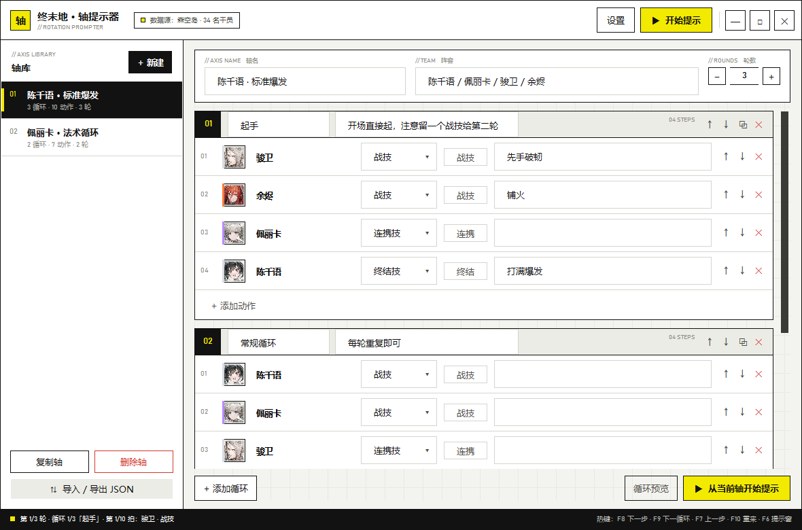
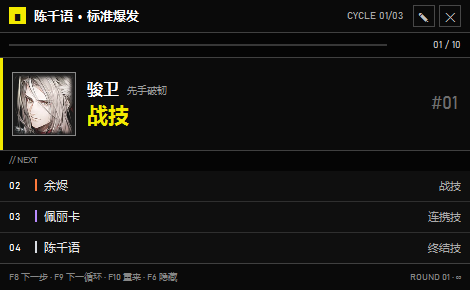
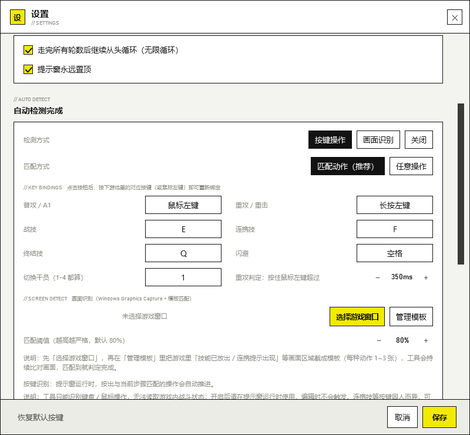
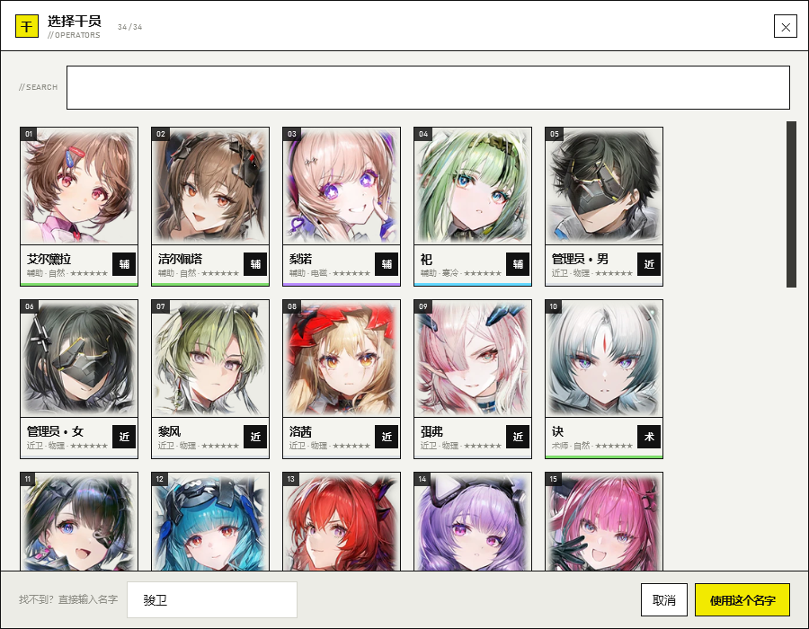

# 终末地 · 轴提示器（Endfield Rotation Prompter）

[](https://github.com/MEIMAOA/EndfieldAxisTeller/actions/workflows/build.yml)
[](LICENSE)
[](https://github.com/MEIMAOA/EndfieldAxisTeller/releases)

[下载 Releases](https://github.com/MEIMAOA/EndfieldAxisTeller/releases) · [问题反馈](https://github.com/MEIMAOA/EndfieldAxisTeller/issues) · [更新日志](https://github.com/MEIMAOA/EndfieldAxisTeller/commits/main)

给《明日方舟：终末地》用的**战斗轴提示工具**：把一条轴拆成多段循环、每个循环里放干员和动作，
开打后挂在屏幕角落，按一下键就推进一个动作，走完一段循环自动进入下一段循环，再也不怕记错顺序。

- 平台：Windows 10 / 11（WPF，.NET 10）
- 数据：内置终末地干员图鉴（含头像），可在设置里用**森空岛**账号同步你实际拥有的干员
- 特点：多轴多循环、全局热键、置顶悬浮窗、可视化编辑、自动保存、JSON 导入导出
- 自动检测（三种方式可切换）：
  - **按键识别**：按出当前步骤对应的动作（普攻 / 重攻 / 战技 / 连携 / 终结 / 闪避 / 切换）就自动推进；
  - **画面识别**：用 Windows 自带 Graphics Capture 抓取游戏画面 + 模板匹配，检测到「技能已放出 / 连携提示出现」等画面特征时自动推进；
  - **视觉 AI**：ONNX 预训练模型（MobileNetV2）提取 1280 维特征 + 本地训练的小分类头，在软件里用样本训练，推理约 3ms；
- 界面：整体视觉参照《终末地》官网（白底 / 黑色实块 / 荧光黄 / 直角细线 / 等宽编号），
  悬浮提示窗参照游戏内「任务目标」追踪面板重做（深色横条、进度条、接下来几拍）



| 悬浮提示窗 | 设置 |
| --- | --- |
|  |  |

### 悬浮提示窗

参照游戏内左上角的任务目标追踪面板设计：

- 顶部：轴名 + 当前循环（`CYCLE 01/03`），右侧是编辑 / 关闭按钮；
- 进度条：本轮第几拍 / 总拍数，荧光黄填充；
- 当前动作：干员头像、名字、动作（黄色大字）、备注、序号；
- 接下来 3 拍：序号 + 属性色条 + 干员名 + 动作，快走完本循环时会提示 `→ NEXT CYCLE` / `→ NEXT ROUND`；
- 底部：全局热键提示 + 当前轮数（单次模式显示 `ROUND 01/03`，无限模式显示 `ROUND 01 · ∞`）；
- 开启自动检测后，右上角显示 `AUTO`，识别到动作时「接下来」行会闪出 `✔ 识别：战技`。

提示窗可拖动，默认贴左上角，位置会记住；双击回到编辑界面，右键可切换轴 / 重置 / 隐藏 / 退出。

| 干员选择 |
| --- |
|  |


---

## 快速开始

1. 到 [Releases](https://github.com/MEIMAOA/EndfieldAxisTeller/releases) 下载 `EndfieldAxisTeller-*-win-x64.zip`，
   解压后运行 `AxisTeller.exe`（或 `启动.bat`）；也可以自行 `dotnet run`（见下方「开发」）。
2. 左侧「轴库」里选中一条轴（第一次启动自带两条示例轴），右边直接改：
   - **轴名 / 阵容 / 轮数**：轮数 = 整条轴重复几遍。
   - **循环**：一条轴可以有多段循环，每段可以改名写备注，支持上移/下移/复制/删除。
   - **动作**：点干员头像换人，填动作（战技 / 连携技 / 终结技……）和备注，支持上移/下移/删除。
3. 点右上角「▶ 开始提示」（或按 `F6`），主窗口收起，屏幕左上角出现悬浮提示窗（样式像游戏内的任务追踪面板）。
4. 回到游戏，按热键推进即可；也可以在设置里开启**自动检测完成**，做对当前步骤的动作就自动前进。
   双击悬浮窗可以回到编辑界面。

### 默认热键（可改）

| 热键 | 作用 |
| --- | --- |
| `F11` | 下一个动作 / 下一拍 |
| `Ctrl+F11` | 跳过本循环，直接到下一循环 |
| `Shift+F11` | 上一个动作 |
| `Ctrl+Shift+F11` | 从头开始 |
| `Alt+F11` | 显示 / 隐藏悬浮提示窗 |
| `Ctrl+F12` | 保存模板（模板管理窗口打开、已拖好识别区域时，把当前画面存成模板） |
| `F11` / `Alt+F11` / `Ctrl+F11` / `Alt+F12` | **只在采样模式下生效**：采正样本 / 采负样本 / 训练 AI / 退出采样 |

热键是**全局**的，游戏窗口在前台也能按，在「设置 → 按键」里可以随便改。

> **关于默认键位**：终末地里 F1~F10 基本都被游戏功能占用，而全局热键会「吃掉」按键、导致游戏收不到，所以默认全部避开了
> F1~F10，只用 **F11 + 修饰键**；`F12` 又常被 Steam 截图等软件占用，所以 `F12` 也只带修饰键使用。
> 老版本存档里的 F6~F10 默认值会在启动时自动迁移到新键位（状态栏会提示），自己改过的键不受影响。

> **保存模板快捷键**的用法：先「设置 → 管理模板」打开模板管理、拖框选好要识别的区域，之后按 `F5`（可改）就能把
> **当前画面**存成当前类型的模板——不用再点按钮，可以在游戏里等技能特效正好出现的瞬间按一下抓帧。
> 模板管理窗口里还有本地快捷键：`Ctrl+S` 保存、`Delete` 删除选中模板、`Esc` 关闭。

### 推进规则

- 按一次「下一个动作」= 前进一拍；一拍是当前循环里的一个动作。
- 走完当前循环的最后一个动作后，再按一次会进入**下一个循环**，循环走完进入下一轮。
- 所有轮数走完后：勾选了「无限循环」就回到第一轮继续；没勾选则显示「整条轴完成」，再按一次从头再来。
- 想直接跳循环，按「下一个循环」热键。
- 开启「自动检测完成」后，做对当前步骤的动作也会自动前进（见下一节）。

---

## 自动检测当前步骤是否完成

「设置 → 自动检测」里可以选三种方式：**按键操作 / 画面识别 / 关闭**。

### 方式一：按键识别（默认）

监听键鼠操作，**识别到当前步骤对应的动作时自动推进**。

- **动作类型**：普攻 / A1、重攻 / 重击、战技、连携技、终结技、闪避、切换干员。每个动作行右侧的小标签
  （如「战技」「连携」）就是当前步骤的类型，可以点它手动指定，也可以由动作文字自动推断。
- **匹配方式**：
  - `匹配动作（推荐）`：只有按出的动作类型和当前步骤一致才推进（例如当前是「连携技」，按 E 战技不会误推进）；
  - `任意操作`：任意绑定的操作都算完成，适合节奏很赶、来不及细分的轴。
- **默认键位**：左键单击 = 普攻、长按左键（超过阈值）= 重攻、`E` = 战技、`F` = 连携技、`Q` = 终结技、
  `空格` = 闪避、`1~4` = 切换干员。不同玩家键位不同，在设置里点一下对应按钮，再按你游戏里的键即可**重新绑定**；
  重攻的「长按阈值」（默认 350ms）也可以调。

### 方式二：画面识别（Windows Graphics Capture + 模板匹配）

不按键、不读内存，直接**抓取游戏画面**，把「技能已放出 / 连携提示出现」等画面特征截成模板，比对命中就判定完成：

1. 「设置 → 自动检测」把检测方式切成**画面识别**，点「选择游戏窗口」在窗口列表里选中《终末地》窗口
   （列表会自动定位到游戏窗口；点「开始提示」时如果还没选，也会按进程名/标题自动找游戏窗口）；
2. 点「管理模板」，等预览出游戏画面后，用鼠标在画面上**拖出要识别的区域**（例如连携技的提示图标、技能释放特效），
   选好动作类型后「保存为模板」；每种动作建议各存 1~3 张不同情况的模板；
3. 「匹配阈值」默认 80%，越高越严格、越不易误触发；提示窗运行时匹配到当前动作类型对应的模板就自动推进。

> 画面识别同样**只读画面、不读内存、不注入游戏**；它判断的是「画面上出现了这张模板」，比按键识别更接近真实完成状态。

### 方式三：视觉 AI（ONNX 预训练特征 + 本地训练分类头）

模板匹配对「会动的特效 / 明暗变化」不够稳，视觉 AI 用样本学出更鲁棒的判定：

- **模型**：内置轻量预训练模型 **MobileNetV2**（ONNX，13MB），把识别区域缩放到 224×224 后提取 **1280 维特征**；
- **训练**：软件里只训练一个很小的分类头（逻辑回归，约 1281 个参数），纯本地、CPU 几百毫秒到几秒；
- **采样（不用切窗口）**：在「设置 → 管理模板」里拖好识别区域 → 点「开始采样」，窗口会收起并显示一个小 HUD；
  然后直接切回游戏玩，**动作出现的瞬间按 F11 采正样本、平时按 Alt+F11 采负样本、Ctrl+F11 训练、Alt+F12 退出**（都可在设置里改）——全程不用点按钮，HUD 会实时显示样本数和采样结果；
  正负各 ≥10 张即可训练；
- **训练结果**：立刻显示「训练集 / 验证集准确率」，模型存到本机（每个动作类型一个，约 66KB）；
- **推理**：单帧约 **3ms**（CPU 单线程），与模板匹配同一套节流/边沿触发逻辑；
- **三种识别方式**（设置 → 自动检测 → 识别方式）：`模板匹配` / `AI 模型` / `两者结合`；某个动作还没训练过模型时会自动退回模板匹配。

> 采样要覆盖「不同亮度、不同角度、不同背景」的同一提示，模型才会稳；换分辨率或 UI 缩放后建议重新采样训练。

### 画面识别不识别？按这个顺序排查

- **触发提示**：提示窗右上角显示 `AUTO`，自动推进时「接下来」那一行会闪一下 `✔ 识别：战技 92%`；底部状态行实时显示
  `画面识别中 · 模板 N 张 · 匹配 xx%`（N 是当前动作类型的模板数）。
- **边沿触发**：模板「出现」的那一下才判定完成；同一个模板一直挂在画面上不会连续推进（模板消失后才会重新武装）。
  手动按热键推进后会重新武装。
- **安全范围**：只有当提示窗在显示、且当前前台不是本工具的编辑 / 设置窗口时才会触发；点在提示窗上的鼠标也不会被误判。
- **原理与局限**：画面识别依赖 Windows Graphics Capture，窗口**独占全屏或最小化时抓不到**，请用无边框窗口模式；
  模板是在某个分辨率下截的，换分辨率/缩放后可能需要重新截；游戏若以管理员权限运行，普通权限的本程序也可能抓不到。

### 画面识别不识别？按这个顺序排查

1. **看提示窗底部**：显示 `模板 0 张` 说明当前动作类型还没有模板 → 去「设置 → 管理模板」按当前动作类型截一张。
2. **看「匹配自测」**：在模板管理窗口右侧，会实时显示 `当前画面 × 【类型】最佳匹配 xx%`。低于阈值（默认 80%）就是
   模板本身不匹配，重新截更明显、更静态的区域。
3. **选对区域**：挑**静态、高对比、每次都会出现**的东西——技能图标、连携提示图标、按钮高亮、进度条；不要选会动的
   特效、角色身体、飘动的粒子。
3.5 **用了 AI 模型还是不准**：看模板管理里的「样本：正/负」数量和验证集准确率；样本太少或正负样本长得太像就重采再训练；
   `AI 模型` 模式在该动作没训练时会自动退回模板匹配（提示窗底部会写）。
4. **匹配度低怎么办**：把阈值降到 70~75%；或者同一动作多截 1~3 张（不同角度/亮度）当备选。
5. **画面全黑**：游戏在用**独占全屏**，改成「无边框窗口」；本工具也会在状态栏提示这一点。
6. **拖框没反应**：按住左键拖出矩形、**松开鼠标即确认**，确认后状态栏会显示「✔ 选区已确认」并启用「保存为模板」；
   拖拽期间程序不会重排预览（旧版本的这一重排会打断鼠标手势），鼠标拖出边界也不会丢。
6. **换了分辨率 / UI 缩放**：模板与画面尺寸不一致，重新截模板即可。

---

## 多轴 / 多循环 / 导入导出

- 左侧「+ 新建」建一条新轴，「复制轴」复制当前轴，「删除轴」删除（至少保留一条）。
- 每条轴包含任意多段循环，每段循环包含任意多个动作；顺序都可以上下移动。
- 「导入 / 导出 JSON」：
  - 导出当前轴 / 全部轴为 `.json` 文件，可备份、发给朋友；
  - 导入支持三种格式：完整存档（`{ "Axes": [...] }`）、轴数组（`[...]`）、单条轴（`{...}`）；
  - 也可以「复制当前轴到剪贴板」，方便直接贴到群里。
- 编辑内容会自动保存，按 `Ctrl+S` 可以立刻保存。

存档位置：`%AppData%\EndfieldAxisTeller\state.json`（设置页有「打开存档目录」按钮）。

---

## 数据来源：森空岛

### 1. 内置干员数据（开箱即用）

- 内置 **34 名终末地干员**：中文名、星级、职业、属性、头像。
- 数据取自森空岛/终末地的干员图鉴数据（社区镜像 `endfield.ooo.run`），头像已转成 PNG 随程序打包，
  **完全离线可用**，不需要登录，也不联网。
- 想更新图鉴：`tools/fetch_assets.ps1`（下载页面与头像）+ `tools/build_catalog.py`（解析并生成
  `AxisTeller/Assets/characters.json`）。

### 2. 森空岛账号同步（可选）

在「设置 → 森空岛数据」里填森空岛 App 的 **token**，点「从森空岛同步角色」，会：

1. 用 token 走森空岛 OAuth（`as.hypergryph.com` / `as.gryphline.com`）换 `cred`；
2. 读取账号绑定的终末地角色（roleId / serverId）；
3. 拉取角色卡片里的角色列表（中文名、星级、职业、属性、头像），缓存到本地，并在选人界面标记「持有」。

- 支持 **国服 · 森空岛** 和 **国际服 · Skport**，在设置里切换。
- token 只保存在本机 `state.json`，不会上传到任何第三方；同步用的接口签名算法参考社区实现
  （`endfield-py` 等开源项目），属于非官方接口，**接口变化时可能失效**，届时仍可继续使用内置数据。
- token 获取方式请自行搜索「森空岛 token 获取教程」（森空岛 App 里抓包获取），把整段 JSON 或纯 token
  直接粘进设置里都可以。

---

## 开发

环境：Windows + .NET 10 SDK。

```powershell
git clone https://github.com/MEIMAOA/EndfieldAxisTeller.git
cd EndfieldAxisTeller

dotnet build AxisTeller\AxisTeller.csproj -c Release
dotnet run --project AxisTeller\AxisTeller.csproj -c Release
```

自测（状态机、存档、角色库、热键解析、动作识别、画面模板匹配等 83 项，CI 也会跑）：

```powershell
.\AxisTeller\bin\Release\net10.0-windows\AxisTeller.exe --selftest selftest-report.txt
Get-Content selftest-report.txt
```

发布可分发版本：

```powershell
dotnet publish AxisTeller\AxisTeller.csproj -c Release -o publish
```

### 目录结构

```
AxisTeller/
  Models.cs            数据模型（轴 / 循环 / 动作 / 设置）+ 干员库
  Engine.cs            提示状态机（推进 / 回退 / 跳循环 / 预览 / 轮数）
  Store.cs             本地存档 + 首次启动示例轴
  HotkeyManager.cs     Win32 全局热键
  InputMonitor.cs      全局键鼠监听（按键识别）
  SklandClient.cs      森空岛登录 / 签名 / 角色同步
  ScreenDetector.cs    画面检测编排（抓帧 + 模板匹配 + 触发）
  ActionKinds.cs       动作类型推断与键位/匹配逻辑
  MainWindow.*         轴编辑器
  OverlayWindow.*      悬浮提示窗
  SettingsWindow.*     设置（按键 / 播放 / 自动检测 / 森空岛）
  OperatorPickerWindow.* 干员选择
  TemplateManagerWindow.* 模板截取与管理
  Capture/             Windows Graphics Capture + SharpDX 互操作
  Vision/              OpenCV 模板匹配、ONNX 特征提取、AI 分类头训练
  Assets/              characters.json + 干员头像 + 图标 + models/mobilenetv2-features.onnx
tools/                 数据抓取、图标生成等开发脚本
docs/                  界面截图
.github/workflows/     CI（构建 + 自测 + 上传产物）
```

---

## 已知限制

- 森空岛接口为非官方接口，需要登录 token，且随游戏版本可能变化。
- 发布版是**框架依赖**版本（含 OpenCV / SharpDX / ONNX Runtime / MobileNetV2 模型，体积约 130MB），需要 .NET 10 Desktop Runtime；
  本机已装 .NET 10 SDK 可直接运行。想发给没装运行时的朋友，可用 `dotnet publish --self-contained true` 重新打包。
- 悬浮窗为置顶窗口，全屏独占（Exclusive Fullscreen）模式下不会显示，请使用「无边框窗口」模式。
- 内置图鉴是快照，新干员上线后可用 `tools/` 里的脚本重新生成，或等账号同步拿到新角色。
- 按键识别基于键鼠操作，无法读取游戏内部状态；游戏使用非默认键位时需要重新绑定。
- 画面识别基于 Windows Graphics Capture：窗口独占全屏或最小化时抓不到；模板在某分辨率下截取，
  换分辨率/缩放后可能需重截；游戏以管理员权限运行时，普通权限的本程序可能抓不到。
- 视觉 AI 的分类头只学过你采样的画面：换分辨率 / UI 缩放 / 换场景后建议重新采样训练；样本要覆盖不同亮度与角度。

---

## 开源许可

- 代码以 [MIT License](LICENSE) 开源，欢迎 Issue / PR。
- `AxisTeller/Assets/Icons` 中的干员头像、名称等素材版权归鹰角网络所有，仅用于本非商业玩家工具的离线展示，
  详见 [THIRD-PARTY-NOTICES.md](THIRD-PARTY-NOTICES.md)。
- 本项目为玩家自用工具，与鹰角网络无关；请勿用于违反游戏用户协议的行为。

## 致谢

- 干员数据：森空岛 / 终末地干员图鉴（社区镜像 `endfield.ooo.run`）
- 森空岛接口与签名算法参考：`endfield-py` 等开源项目
- 界面设计参考：《明日方舟：终末地》官网与游戏内 HUD

如果这个工具帮到了你，点个 ⭐ Star 就是最大的支持。
